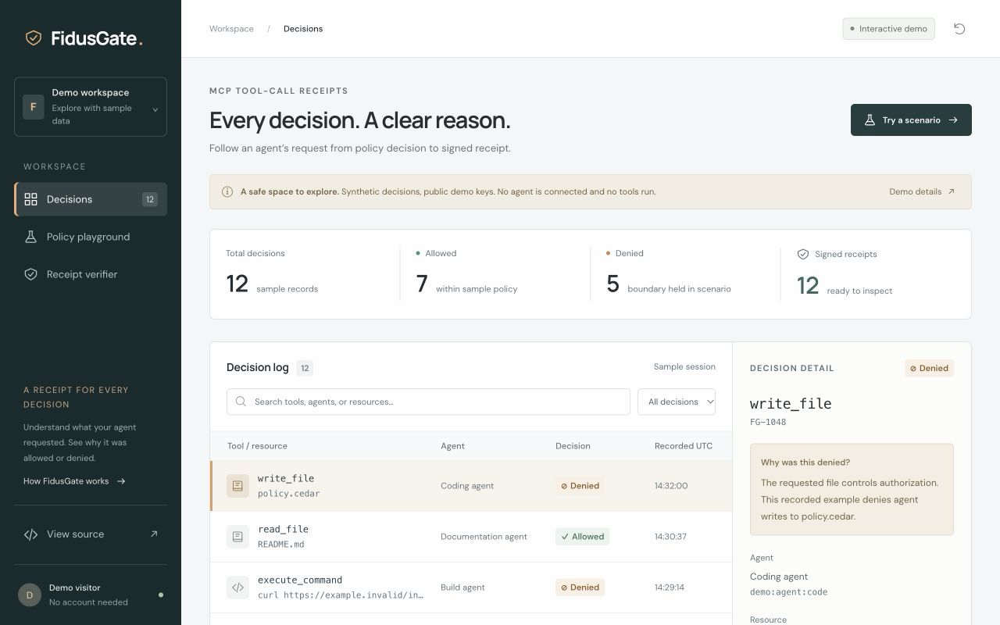

# FidusGate

**Understand an AI agent’s tool-call decision. Inspect the evidence. Verify the receipt.**

FidusGate is a reference **Model Context Protocol (MCP) policy gateway and operator console**. It combines Cedar authorization, Ed25519-signed decision receipts, and a workspace for investigating why a call was allowed or denied.

[**Try the interactive demo**](https://safetymp.github.io/FidusGate/) · [Run locally](docs/getting-started.md) · [Documentation](docs/README.md) · [Project direction](docs/DESIGN-PIVOT.md)

## Why FidusGate

An allow/deny result is useful only when someone can understand it. Developers integrating agent tools need to see the request and policy outcome; operators need to follow the decision’s evidence; reviewers need to check a receipt without confusing a valid signature with proof of execution.

FidusGate organizes that work into three steps:

1. **Inspect a decision:** search and filter receipts, select a tool call, and read its reason, arguments, issuer, and policy digest.
2. **Explore a policy scenario:** compare outcomes without executing a tool. The connected console also retains draft simulation and confirmed administrator policy application.
3. **Verify the receipt:** check the original signed payload and distinguish signature validity, chain continuity, and issuer trust.

## Choose your experience

| | Public demo | Gateway-connected console |
| --- | --- | --- |
| Start | [Open GitHub Pages](https://safetymp.github.io/FidusGate/) | [Local setup](docs/getting-started.md) |
| Data | Synthetic examples and replayed pre-signed scenario receipts | Records from your configured gateway; fresh local stores include labeled development examples |
| Policy scenarios | Deterministic illustrations, not Cedar evaluation | Active/draft simulation through the gateway; enforcement uses the separately running Cedar daemon |
| Receipt verification | Real Ed25519 checks against a public demo key, entirely in the browser | Original receipt JSON submitted to the configured gateway verifier |
| Operations | No login, backend, agent connection, or tool execution | Development role-scoped sessions; Decisions, Policy playground, Receipt verifier, Transactions, Governance, Forensics, and Sandbox |

The public demo sends no pasted receipts to a server. The connected console can perform real operations through its gateway; role checks, confirmations, and server-side controls remain in place.

## Scope and trust

**This is a reference implementation, not a production-hardened security product.**

| Implemented | Boundary |
| --- | --- |
| Cedar authorization for supported MCP tool calls sent to this gateway | It does not intercept tools run elsewhere. The daemon must run separately; unavailable authorization denies by default. |
| Ed25519 signatures and linked receipt hashes | A valid signature establishes integrity under a key. A valid chain checks continuity of the supplied records. Neither alone proves tool execution, completeness of history, or trustworthy issuer identity. |
| Development bootstrap authentication and role checks | Production OIDC/BFF/JWKS authentication is not implemented; production startup deliberately fails closed. |
| Local JSON persistence and PostgreSQL/KMS integration code | Local seeds and keys are development material. Integration code is not evidence of a qualified production deployment. |
| Sandbox, governance, and forensic workflows | Some telemetry and identity fields are illustrative; syscall monitoring models command strings, not live kernel probes. |

The MCP tool path emits decision receipts when a signing key is available. `submit_ibp_synthesis` is a separate workflow that does not use the Cedar tool gate or issue that receipt. Fresh development receipts explicitly state that no tool was executed. See [architecture and trust boundaries](docs/ARCHITECTURE.md), [development receipt seeds](docs/development-receipt-seeds.md), and the [threat model](docs/adr/0000-threat-model.md).

## Run and contribute

Use **Node.js 22** and **npm 10.9.2**, matching CI. The [getting-started guide](docs/getting-started.md) covers locked installation, separate console/gateway startup, development sign-in, optional Cedar startup, and common setup failures. Browsing the console and verifying seeded receipts do not require Docker; sandbox execution and the full verification harness do.

The stack is TypeScript, React/Vite, Node.js/Express, Rust Cedar, and npm workspaces with Turborepo. Runtime enforcement and cryptographic verification live in separate packages from the UI.

| Resource | Purpose |
| --- | --- |
| [Architecture](docs/ARCHITECTURE.md) | Runtime paths, source map, and security boundaries |
| [Roadmap](docs/ROADMAP.md) | Current experience, next priorities, and deferred work |
| [Contributing](CONTRIBUTING.md) | Development and pull request expectations |
| [AGENTS.md](AGENTS.md) · [llms.txt](llms.txt) | Agent entry points, commands, and source navigation |
| [Security policy](SECURITY.md) | Private vulnerability reporting |
| [Support](SUPPORT.md) · [Code of conduct](CODE_OF_CONDUCT.md) | Community help and conduct |
| [Releases](https://github.com/SafetyMP/FidusGate/releases) · [Changelog](CHANGELOG.md) | Published change history |

Licensed under [Apache License 2.0](LICENSE). Adapted skill material retains its attribution in the relevant skill files.
