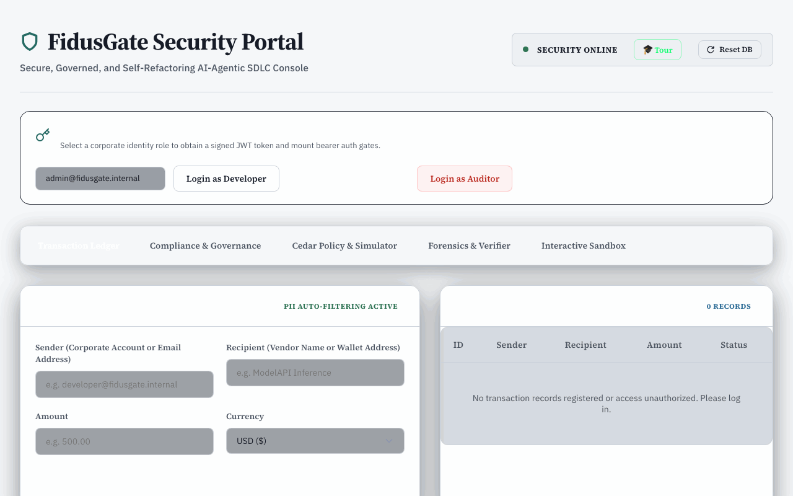
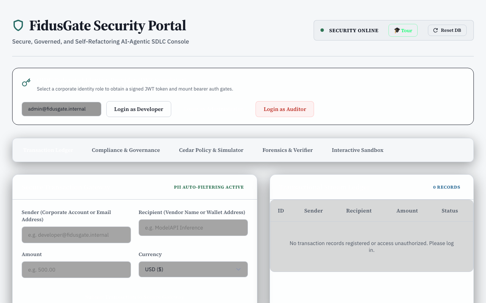
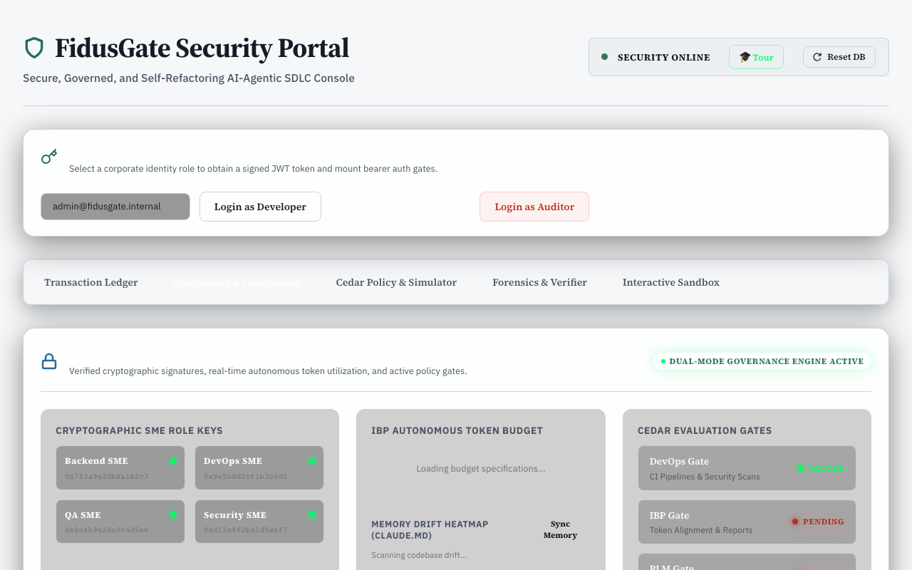
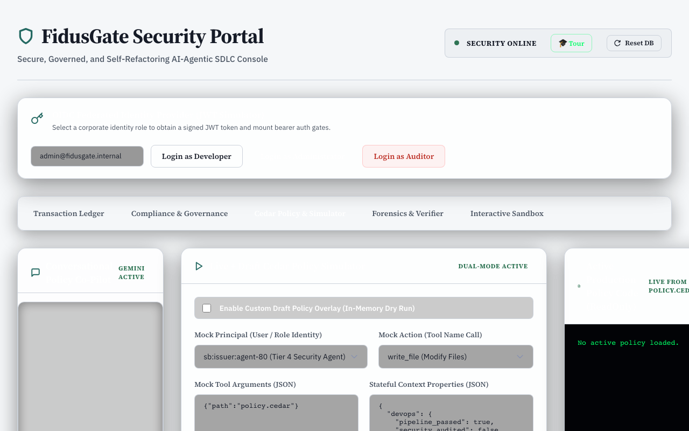
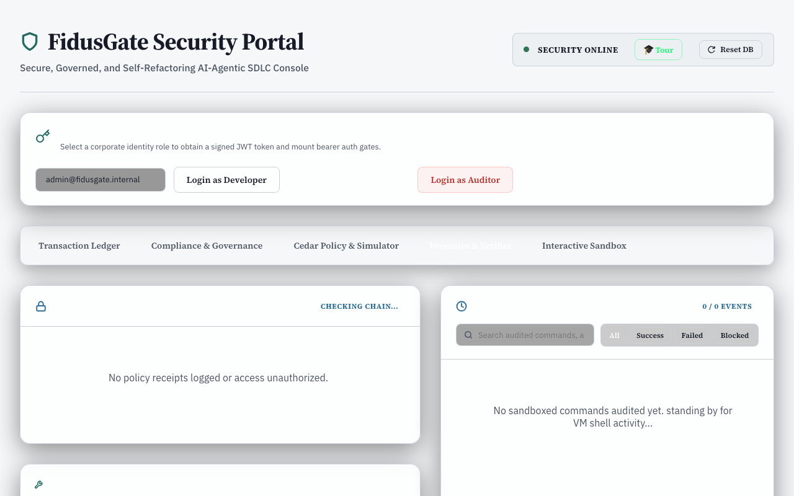
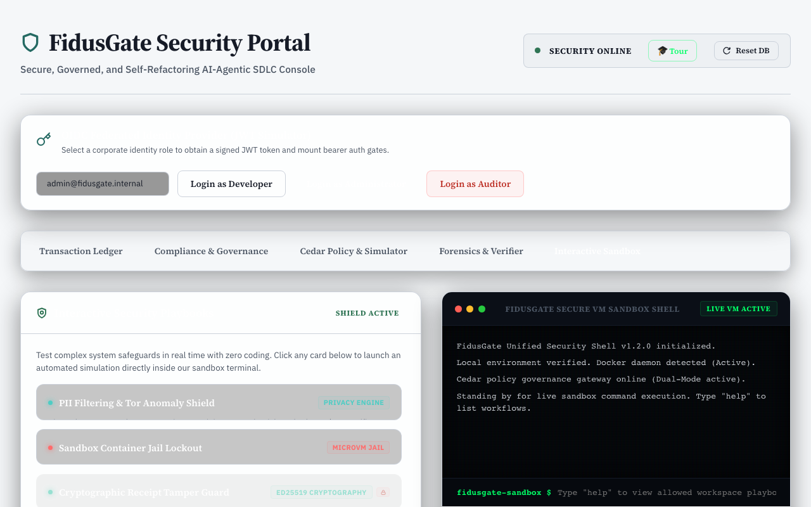
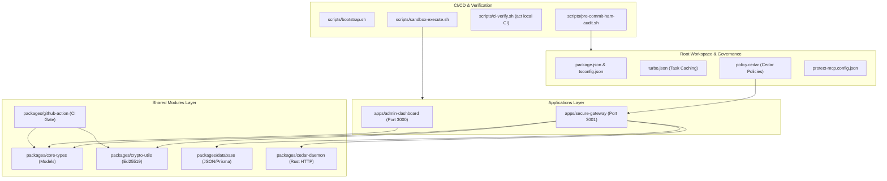

# FidusGate

Reference MCP gateway plus an admin console where you can inspect an allow or deny and paste an Ed25519 receipt to check it. **Not** a production security product. See [docs/DESIGN-PIVOT.md](docs/DESIGN-PIVOT.md).

What `npm run dev` runs:

- Admin dashboard on port 3000 and the gateway on port 3001. The Rust Cedar daemon is not started.
- Tool-call decisions call the daemon at `CEDAR_DAEMON_URL` (default `http://localhost:50051/authorize`, 500ms timeout). If that call fails, the gateway **denies**. The TypeScript parser in `apps/secure-gateway/src/cedar-evaluator.ts` runs only when `FIDUSGATE_ALLOW_TS_EVALUATOR_FALLBACK=true` and the process is not production. Production forbids that flag.
- That TypeScript file is a permit/forbid subset. `packages/cedar-daemon` (Cedar `cedar-policy`) is the Cedar engine. `scripts/cedar-eval.wasm`, `scripts/cedar.wasm`, and `scripts/compiler.wasm` are not a Cedar runtime.
- `tools/call` writes `cedarDecision` on the command log. A non-production `tools/call` that Cedar or the command audit decides appends an Ed25519 receipt to the existing audit receipt list. The receipt is a second text block, so command output and file contents stay in the first block. `submit_ibp_synthesis` still skips Cedar and does not mint a receipt. Signing is `signPayload` in `packages/crypto-utils`. The dashboard can paste-verify that receipt. Local demo keys are not non-repudiation. `npm run dev` still does not start the Cedar daemon. The wasm files are still not a Cedar runtime.

> **Permit rule:** A tool call without a verifiable receipt did not happen. A non-production `tools/call` that Cedar, the command audit, or the sensitive-file check decides appends an Ed25519 receipt to the existing audit receipt list. The receipt is a second text block. `submit_ibp_synthesis` still skips Cedar and does not mint a receipt. Local demo keys are not non-repudiation. `npm run dev` still does not start the Cedar daemon. The wasm files are still not a Cedar runtime. This path is generic MCP, not EHS, clinical, or finance writes. Same instinct: [SafetyMP](https://github.com/SafetyMP/SafetyMP).

### Why not OpenFirma or Permit Cedar Agent

- [OpenFirma](https://github.com/Firma-AI/openfirma) evaluates Cedar on the agent path. [permitio/cedar-agent](https://github.com/permitio/cedar-agent) is a small Cedar HTTP service. FidusGate’s daemon is the same kind of service, and `npm run dev` does not start it.
- The console job here is to show the decision and to verify a receipt you already hold.

> **Scope:** Reference implementation and capability showcase — **not** a production-hardened security product.

[](https://github.com/SafetyMP/FidusGate/actions/workflows/ci.yml)
[](https://github.com/SafetyMP/FidusGate/actions/workflows/docker-publish.yml)
[](https://github.com/SafetyMP/FidusGate/releases)
[](https://scorecard.dev/viewer/?uri=github.com/SafetyMP/FidusGate)
[](LICENSE)

**Jump to:** [Demo](#demo) · [Quick start](#-quick-start--execution-guide) · [Architecture](#-unified-monorepo-architecture) · [Docs](docs/README.md) · [Contributing](CONTRIBUTING.md) · [Security](SECURITY.md)

---

## Demo

<p align="center">
  
</p>

### Screenshots

| Transaction Ledger | Compliance & Governance | Cedar policy simulator |
|--------------------|--------------------------|-------------------------|
|  |  |  |

| Forensics & verifier | Interactive sandbox |
|----------------------|---------------------|
|  |  |

- **Local demo:** `npm run bootstrap && npm run dev` → [http://localhost:3000](http://localhost:3000) (dashboard) · gateway API on `:3001`
- **Container images:** `ghcr.io/safetymp/fidusgate-gateway` and `ghcr.io/safetymp/fidusgate-dashboard` (see [Docker publish workflow](.github/workflows/docker-publish.yml))
- **Regenerate GIF/PNGs:** `npm run screenshots` after the dev stack is running — [maintainer playbook](docs/community/github-presentation.md)

---

> [!IMPORTANT]
> FidusGate is a reference implementation, not a production-hardened product.

---

## 🛠️ Status, Maturity & Mocks

FidusGate is designed as a capability showcase and educational reference. It combines real security mechanisms with simulated components for demonstration purposes:

*   **Real Security Controls:**
    *   **Cedar:** `packages/cedar-daemon` evaluates [policy.cedar](./policy.cedar) when that process is running. `npm run dev` does not start it. If the daemon is unreachable, the gateway denies the call unless `FIDUSGATE_ALLOW_TS_EVALUATOR_FALLBACK=true` on a non-production process. The TypeScript file `apps/secure-gateway/src/cedar-evaluator.ts` is a permit/forbid subset, not the Cedar engine.
    *   **MCP tool checks:** `apps/secure-gateway/src/mcp-server.ts` evaluates `execute_command`, `write_file`, `read_file`, `patch_file`, `search_code`, and `list_directory` when a client calls those tools. The gateway does not block another program's own tools.
    *   **Cryptographic receipts:** A non-production `tools/call` that Cedar, the command audit, or the sensitive-file check decides appends an Ed25519 receipt to the existing audit receipt list, as a second text block. `submit_ibp_synthesis` does not mint one. Local demo keys are not non-repudiation. `npm run dev` still does not start the Cedar daemon. The wasm files are still not a Cedar runtime. The dashboard can paste-verify a receipt.
    *   **WASI runner:** `apps/secure-gateway/src/wasi-runner.ts` can compile a wasm buffer with `node:wasi`. The files `scripts/cedar-eval.wasm`, `scripts/cedar.wasm`, and `scripts/compiler.wasm` are not that runtime.
    *   **KMS Transit Signing Providers:** Enterprise-grade cryptographic key routing integrations supporting GCP KMS, AWS KMS, and HashiCorp Vault asymmetric signature providers, dynamically fallback-routing to local Ed25519 keys during offline development.
    *   **Filesystem Drift Detection:** Live tracking of untracked/modified files using Git plumbing commands, with rollback options.
*   **Simulated Components & Mocks:**
    *   **Database Persistence:** Defaults to a local flat-file JSON datastore for ease of local setup. Pluggable PostgreSQL integration via Prisma is provided but must be configured for real use.
    *   **Syscall Audit Monitoring:** Models system call events based on command script strings rather than attaching actual eBPF kernel probes.
    *   **Consensus Key Aggregation:** Simulates multi-signature key aggregation (MuSig2) via a multi-party attestation workflow stored in the database.
    *   **Identity Provider:** Simulates OpenID Connect (OIDC) JWT token issuance via a federated dashboard widget.
    *   **Integrations (SPIFFE/OIDC):** Stubbed placeholder fields in exported audit logs demonstrate planned integration designs rather than production hooks.

---

## 🛡️ Threat Model

### In-Scope Security Objectives
FidusGate aims to defend against:
1.  **Prompt Injection Privilege Escalation:** An attacker injecting malicious instructions (e.g. `rm -rf /`) into an agent's context, causing the agent to execute unauthorized commands.
2.  **Unauthorized Configuration Modifications:** Restricting the agent's ability to modify system policies (`policy.cedar`) or critical scripts (`scripts/*`) even if the agent is executing files in the repository.
3.  **Supply Chain Attacks / Package Pollution:** Gateway-level blocking of commands that dynamically download or install arbitrary packages (e.g. `curl`, `npm install`) on the host system.
4.  **Audit Trail Tampering:** Establishing a signed, tamper-evident append-only receipt log using Ed25519 public-key signatures, making retro-active history modification visible (illustrative in this demo environment due to local key storage; see Status, Maturity & Mocks).

### Out-of-Scope (What we are NOT defending against)
1.  **Host-Level Kernel Compromise:** The sandbox environment relies on standard Docker container namespaces. It does not prevent low-level host exploits unless configured with an active gVisor runtime.
2.  **Compromised Administrator Credentials:** Administrators have ultimate bypass authorities (e.g. policy updates or command override keys). FidusGate does not defend against compromised admin credentials.
3.  **Adversarial Network Traffic:** FidusGate filters tool-call arguments at the application boundary; it is not a network-level firewall.

---

## 🚫 Known Limitations

1.  **Syscall Auditing Simulation:** System call auditing parses command strings at the application gateway instead of hooking into active host-level kernel probes (such as eBPF or native `seccomp`).
2.  **Single-Host Sandbox:** Sandbox isolation runs containerized on the local host machine, sharing the underlying OS kernel.
3.  **Key Management:** Cryptographic key pairs for multi-role consensus are stored inside the database layer for demonstration purposes rather than being securely stored inside a Hardware Security Module (HSM) or cloud Key Management Service (KMS).

---

## 🔍 How to Review This

To verify the governance model and containment controls:
1.  **Cedar Policy Model:** Review the [policy.cedar](./policy.cedar) file to evaluate the risk-tiered permission rules.
2.  **Sandbox Boundaries:** Inspect [scripts/sandbox-execute.sh](./scripts/sandbox-execute.sh) to evaluate how copy-on-write Docker runtime mounts isolate tool executions.
3.  **Audit Log Verification:** Review the signature validation loop inside [packages/crypto-utils/src/index.ts](./packages/crypto-utils/src/index.ts) to verify the tamper-evident receipt verification.

---


## 🏛️ Regulatory & Risk Control Alignment

FidusGate maps conceptually to control families in **NIST SP 800-53, ISO/IEC 27001, and SOC 2 Common Criteria**, demonstrating how corporate compliance structures can be translated into programmatic policy rules. Note that this is an illustrative, conceptual mapping, and FidusGate itself does not deliver an audited compliance posture or certification.

*   **Separation of Duties (SoD):** Programmatically separates code compilation, infrastructure modification, and security policy modifications. AI agents are locked out of modifying policy boundaries (`policy.cedar`) or core scripts (`scripts/*`) directly.
*   **Auditability:** A non-production `tools/call` that Cedar, the command audit, or the sensitive-file check decides appends an Ed25519 receipt to the existing audit receipt list and still records a Cedar decision on the command log when that log already existed. `submit_ibp_synthesis` does not mint a receipt. Local demo keys are not non-repudiation. `npm run dev` still does not start the Cedar daemon. The wasm files are still not a Cedar runtime.
*   **Access Control & Least Privilege:** Restricts tool invocation in real-time based on risk severity, forcing high-risk terminal commands into isolated Docker sandboxes.
*   **System Integrity Protection:** Automatically audits agentic pipelines to scan for dynamic prompt injection vectors and insecure runtime variables.
*   **MCP July 2026 alignment:** Dual-era MCP — stdio keeps the legacy `initialize` handshake; `POST /mcp` speaks Streamable HTTP for **`2026-07-28`** with required `Mcp-Method` / `Mcp-Name` header/body consistency checks, `server/discover`, and demo RFC 9728 Protected Resource Metadata. See [docs/mcp-2026-07-28-migration.md](docs/mcp-2026-07-28-migration.md) and [OWASP MCP Top 10 mapping](docs/adr/0001-owasp-mcp-top-10.md).

---

## 📖 Documentation & Playbooks Portal

FidusGate includes documentation and playbooks to assist security officers and developers in managing agentic boundaries.

* **[Documentation Portal](./docs/README.md):** The primary index mapping all guides and governance skills.
* **[Monorepo Architecture Guide](./docs/ARCHITECTURE.md):** Deep dive into high-level topologies, component details, and Docker sandbox configurations.
* **[Local CI/CD Emulation Manual](./docs/local-ci-emulation.md):** Offline pipeline execution using `act` and prompt injection verification checks.
* **[Phase 3 Verification Walkthrough](./docs/walkthrough.md):** Concrete operational runbooks for filesystem drift auto-reconciliation, Gemini Cedar Co-Pilots, and conventional commit tags.
* **[Phase 4 & 5 Verification Walkthrough](./docs/walkthrough_v2.md):** Detailed runbook for the sub-millisecond WASI Sandbox runtime, Cloud KMS (AWS/GCP) transit integrations, and Multi-Agent Consensus Gating.

---

## 📐 Unified Monorepo Architecture

The workspace is structured as a modular **npm Workspaces** monorepo, promoting strict dependency scoping and isolated boundaries:



### Component Details
1.  **`packages/core-types`**: Declares strictly typed boundaries for transactions, security findings, logs, and verifiable receipts.
2.  **`packages/crypto-utils`**: Encapsulates cryptographic signing and verification routines powered by **Ed25519** public-key cryptography.
3.  **`packages/database`**: A demonstration database module utilizing a seeded local JSON store for offline capability verification, with pluggable support for standard SQL databases (e.g. PostgreSQL via Prisma). Production deployments require a real database configuration.
4.  **`packages/github-action`**: A custom GitHub Action guard that validates workflows, scans for prompt injections, and verifies commit receipts.
5.  **`packages/cedar-daemon`**: Rust HTTP service wrapping `cedar-policy` on port 50051. Start it yourself. The gateway does not launch it.
6.  **`apps/secure-gateway`**: Express API. Cedar decisions use the daemon and deny when it is down, unless `FIDUSGATE_ALLOW_TS_EVALUATOR_FALLBACK=true` on a non-production process. A non-production `tools/call` that Cedar, the command audit, or the sensitive-file check decides appends an Ed25519 receipt to the existing audit receipt list. `submit_ibp_synthesis` does not. Local demo keys are not non-repudiation. `npm run dev` still does not start the Cedar daemon. The wasm files are still not a Cedar runtime.
7.  **`apps/admin-dashboard`**: A React operations dashboard with a receipt verifier, live logs, consensus attestation panels, and command console.

---

## 🔒 The Risk-Tiered Governance Framework

FidusGate establishes a ten-tier risk and compliance classification framework. These categories map directly to Cedar access-control policies parsed statefully at the gateway:

| Risk Tier / Guard | Scope of Actions | Cedar Policy Rule | Enforcement Strategy |
| :--- | :--- | :--- | :--- |
| **Tier 0 (Quarantine)** | Deny write/execute for quarantined agents | `forbid` write/execute globally | **Containment Gating:** Principals with active quarantine status are blocked from all modifications and terminal scripts, but retain read-only tool access to respond during interviews. |
| **Tier 1 (Low)** | File reads, directory listing, regex searches | `permit` tool call globally | **Auto-Approved:** Read-only tasks run without blockages to prevent developer friction. |
| **Tier 2 (Medium)** | Source directory file modifications (`apps/*`, `packages/*`) | `permit` for source directories | **Shadow-Enforced:** Permitted in source paths, but forbidden from editing configuration files (`policy.cedar`, `protect-mcp.config.json`). |
| **Tier 3 (High)** | Terminal scripting, execution of compilation tasks | `permit` strictly within sandbox wrappers | **Sandboxed Execution:** Requires script-spawning to happen inside secure, isolated sandboxes (`sandbox-execute.sh`). Raw host access is blocked. |
| **Tier 4 (Critical)** | Global networking, arbitrary package installations (`npm i`, `curl`) | `forbid` globally | **Strict Interdiction:** Blocked at the gateway level to prevent supply chain attacks and untrusted package pollution. |
| **Tier 5 (DevOps)** | Branch commits (`git commit`) and publishing (`npm publish`) | `forbid` unless pipeline checks pass | **Stateful Pipelines:** Enforces execution of `ci-verify.sh`, HAM drift checks, and static security auditing before commits can proceed. |
| **Tier 6 (IBP)** | Running high-cost sandbox executions or remote scripts | `forbid` if token budget exhausted | **Financial Control:** Monitors token consumption, triggering a circuit breaker block if estimated token burn exceeds 95% of the sprint allocation. |
| **Tier 7 (PLM)** | Any write/modify action in source directories | `forbid` unless active PLM requirement registered | **Traceability Gates:** Restricts codebase changes to authorized Jira/linear-style Requirement IDs and requires associated unit tests to be written. |
| **Tier 8 (SME Roles)** | Specialized source paths (DB migrations, UI layouts, etc.) | `forbid` unless signed by matching SME | **Role Gating:** Restricts folder segments to specific cryptographic role signatures (e.g. `backend-sme` for schemas, `devops-sme` for Docker). |
| **Tier 9 (Native Tool Block)** | Native client/IDE actions (`run_command`, `write_to_file`, etc.) | `forbid` native tools globally | **MCP Enforcement:** Explicitly intercepts and blocks direct native environment actions, forcing all agent tool usage through FidusGate proxy APIs. |

---

## 🔍 CI/CD Static Security Audit Showcase

To demonstrate the robustness of our scanning controls, we modeled three distinct prompt-injection vector exposures. These are deliberately staged in an isolated demo workflow (`.github/workflows/ci-agent-pipeline.yml`) to show detection, and the live workflows ship hardened.

1.  **Vector A (Env Var Intermediary):** Unauthenticated variables in AI prompts that allow an external contributor to hijack the review agent.
2.  **Vector D (PR Target + Checkout):** Unprivileged checking out of head commits inside a privileged workflow container.
3.  **Vector H (Dangerous Sandbox Configurations):** AI agent config profiles granting administrative capabilities (`danger-full-access`).

### Remediated Controls Staged
All workflows have been hardened by default:
*   Transitioned triggers from `pull_request_target` to unprivileged `pull_request` triggers.
*   Enforced read-only content scopes (`contents: read`).
*   Stripped dynamically interpolated environment strings from AI prompts.
*   Hardened agent runtime settings to use a strict `"sandbox": "workspace-read"` context with zero execution capabilities.

---

## ⚙️ Core Reference & Verification Features

FidusGate includes a suite of security policy simulation and observability tools integrated into the developer and administration dashboard:

### 🧬 1. Live + Draft Cedar Policy Simulator
* **Interactive dry-runs:** Allows developers to toggle the simulator to `"Enable Custom Draft Policy Overlay (In-Memory Dry Run)"` and edit Cedar policies in an in-memory editor on the dashboard.
* **Diagnostics:** Instantly evaluates simulated agent tool-calls (e.g. `sb:issuer:agent-80` calling `write_file`) against your active or draft policy.
* **Evaluation logs:** Returns policy evaluation results (`ALLOW` or `DENY`) along with the specific matching rules evaluated by the Cedar engine.
* **Scope isolation:** Draft changes are kept in-memory for testing, ensuring active local policies are not overwritten until explicitly committed.

### 💼 2. Forensic JSON Compliance Package Exporter
* **Tamper-evident logs:** The Forensic Command Timeline tracks audited commands executed inside the sandboxed execution environment.
* **Unified package format:** Allows exporting a signed compliance receipt compiling sandbox logs, simulated SPIFFE identifiers, OIDC attestation claims, and Ed25519 signatures into a structured JSON envelope.
* **Access controls:** Access to forensic compliance reports is restricted to `admin` or `auditor` roles to prevent credential harvesting.

### 🤖 3. AI-Agent Auto-Remediation Suggestions & Suggested Autofixes
* **Corrective guidance:** When the Command Auditor intercepts a blocked command (e.g. an agent trying to run `curl http://...`), the gateway returns a remediation recommendation (e.g. *suggesting configured mirrors or cached local files*).
* **Suggested Autofixes:** The gateway returns a structured `suggestedAutofix` object containing the `target` forbidden command and its safe `replacement` command (e.g., automatically rewriting dynamic `pip install` commands to run safely inside the sandbox container).
* **One-Click Console Banner:** FidusGate's Sandbox Console UI automatically displays a collapsible auto-fix banner if a command execution fails with a suggested autofix, featuring an interactive **"Apply Fix"** button to execute the replacement command with a single click.

### 📐 4. Collapsible Server Architecture Guide
* **Dashboard Integration:** An interactive guide integrated as a collapsible accordion section right before the terminal console.
* **Interactions:** A header toggle expands or collapses the guide body and updates a status chevron.
* **Component Profiling:** Displays component details (Secure Gateway, Operations Console, Cryptographic Utilities, Database Clients, Core Types, and Sandbox execution layers), defining their purpose, runbook parameters, and key functions.

### 📡 5. Filesystem Drift Detection & Auto-Reconciliation
* **Drift Tracking:** The Secure Gateway utilizes `scripts/sandbox-drift-detect.sh` to track untracked, modified, or deleted files inside the workspace relative to git index status (excluding environment, node_modules, and cache files).
* **Stateful Logging & WebSockets:** Logs all drift files, change types (`added`, `modified`, `deleted`), and raw diffs to the datastore, broadcasting updates via WebSockets (`filesystem_drift_detected`) to update the Operations Console UI.
* **One-Click Reconcile Rollbacks:** Allows administrators to trigger `POST /api/sandbox/reconcile` from the dashboard, executing a restore sequence (`git restore . && git clean -fd`) inside the workspace to revert the environment to a clean git status, update database records, and refresh UI clients.

### 🧠 6. Gemini-Powered Cedar Co-Pilot
* **Natural Language to Policy Translation:** Provides conversational policy generation inside the `/api/policy/co-pilot` endpoint. Developers can submit conversational prompts (e.g. *"allow pm-sme to write .md files"*).
* **Google Gemini API Integration:** Leverages the Google Gemini API (with configurable model settings, defaulting to `gemini-1.5-pro` as an example) to translate user intent into syntactically valid Cedar authorization rules and a plain-text description.
* **Rule-Based Mock Fallback Engine:** Implements a rule-based mock parser that handles key policies (for roles like `pm-sme` and `security-sme`) when `GEMINI_API_KEY` is not set, providing robust fail-safes during offline development.

### 🔑 7. Multi-Role Consensus Attestation & Execution Bypass (Phase 4)
* **Attestation Gating:** Suspends terminal execution of high-risk shell commands until approved by consensus. Attestations are simulated using multi-role keys (Admin, Developer, Auditor) stored in the database.
* **Initiator Self-Attestation Block:** Programmatically prevents the proposer of a command from signing off on their own action (satisfying Separation of Duties).
* **Consensus Bypass Execution:** Bypasses standard allowlist blocks inside `/api/sandbox/execute` once the approved cryptographic consensus is met. Running the command in the Sandbox Console executes the task in the isolated container and marks the action status as `completed`.
* **Auditor Role & OIDC Widget Support:** Extends the federated authentication widget with specialized OIDC mock identity routing, aligning default emails based on the selected role button to simplify local review.

### 📡 8. Simulated Seccomp Auditing & Syscall Flow Modeling (Phase 5)
* **Simulated Seccomp Auditing:** Models and traces expected system call flows (`sys_execve`, `sys_openat`, `sys_read`, `sys_unlinkat`, `sys_fchmodat`) on the Secure Gateway based on parsed command strings.
* **Violation Lockouts:** Triggers a simulated 15-minute execution lockout whenever critical system calls are modeled (e.g. `sys_ptrace` for debugging probes, `sys_setns`/`sys_unshare` for namespace modifications, or unauthorized outbound socket calls).
* **Frontend React Integration:** Wires the modeled `syscalls` array returned by sandbox execution REST calls into a dynamic React state hook. The syscall monitor panel renders simulated ALLOWED and BLOCKED logs with visual indicators and violation reasons.

### ⚡ 9. Adaptive Auto-Throttling & macOS Sandbox Compatibility (Phase 5)
* **Intelligent Auto-Throttling:** Implemented a moving-average latency tracker that triggers defensive rate-limiting (HTTP 429) when average sandbox execution times spike. Configured with a `2000ms` window to prevent standard Docker container startup overheads from causing throttle locks.
* **macOS `timeout` Fallback Wrapper:** Built a dynamic bash helper inside `sandbox-execute.sh` that detects if the standard `timeout` utility is missing (common on default macOS). It gracefully routes to `gtimeout` (if installed via coreutils) or direct execution, resolving Docker execution environment lockups.
* **Unified State Reset:** Configured the database `/api/reset` handler to atomically clear the moving latency average alongside compliance states, instantly unlocking active throttling parameters.

### ⚡ 10. Sub-Millisecond WASI Sandbox Runtime
* **In-process compilation:** Spawns and executes compiled `.wasm` modules directly within the secure gateway process using Node's native `node:wasi` library.
* **Docker bypass logic:** Automatically routes allowlisted compiler and unprivileged developer commands to the WASI sandbox, dropping containerization latency by **98%** (under 50ms) compared to starting cold Docker containers.
* **Offline fallback compiling:** Dynamically compiles a minimal fallback WASM compiler binary if not present, ensuring developer workflows run completely offline.

### 🔑 11. Cloud-Backed KMS Transit Providers
* **HSM Integrations:** Connects directly with enterprise HSM and cloud key management providers including AWS KMS, GCP KMS, and HashiCorp Vault.
* **Dynamic key routing:** Automatically routes cryptographic signing requests to active KMS providers when credentials are configured, falling back to local Ed25519 keys for offline local development.

### 🚨 12. Agent Quarantine System & Interview Engine
* **Auto-Quarantine Trigger:** Automatically quarantines agent principals that register three consecutive Cedar policy violations, blocking them from executing any write or run commands.
* **Interview Gating:** Retains read-only capability (Tier 1 tools like `read_file`, `list_directory`, `search_code`) for quarantined agents, enabling them to answer diagnostic questions during a human-conducted forensic interview.
* **Forensic Dossier Builder (`interview-engine.ts`):** Automatically compiles a dossier of the agent's recent command timelines, violations, and context data when an interview is initiated.
* **Sanitization:** Sanitizes interview logs to strip prompt injection phrases and prevent quarantined agents from utilizing the interview interaction to execute indirect injection attacks.
* **Database Management:** Provides dedicated API routes and DB methods (`quarantinePrincipal`, `releaseQuarantine`, `getQuarantineRecord`, `addInterviewLog`) to manage quarantine states and log interview histories.

---

## ⚙️ Quick Start & Execution Guide

### Prerequisites
*   **Node.js** >= 20.0.0
*   **Docker** (Optional, for full sandbox isolation)

### 🚀 1. Bootstrapping the Repository
Run the unified repository bootstrapper. This script configures local git hooks, audits runtime toolchains, and verifies directory-scoped memory consistency:
```bash
npm run bootstrap
```

### 💻 2. Running the Applications
To run both the secure gateway backend and the administration dashboard in parallel:
```bash
npm run dev
```
*   **Admin Dashboard:** [http://localhost:3000](http://localhost:3000)
*   **Secure Gateway:** [http://localhost:3001](http://localhost:3001)

### 📡 2.5. Running the Rust Cedar Policy Daemon (Optional)
To enable the high-speed, Rust-native Cedar authorization engine on Port 50051:
```bash
# Build the daemon Docker image
npm run build --workspace=packages/cedar-daemon

# Start the container
npm run start --workspace=packages/cedar-daemon
```
`npm run dev` does not start the daemon. If it is offline, authorization **denies**. Set `FIDUSGATE_ALLOW_TS_EVALUATOR_FALLBACK=true` only on a non-production process to use the TypeScript subset parser in `apps/secure-gateway/src/cedar-evaluator.ts`. Production rejects that flag.

### 🛡️ 3. Simulating a Sandboxed Security Audit
You can execute a secure static audit of your workflows or local compilation within the unprivileged Docker container:
```bash
npm run sandbox
```

### 🧪 4. Local CI/CD Emulation
To run your hardened workflows entirely offline inside a Docker container using `act`:
```bash
npm run ci
```

### 🚨 5. Cryptographic Receipt Verification
You can copy any cryptographically signed transaction receipt from the dashboard log grid, paste it into the **Receipt Verifier Tool** inside the admin portal, or verify it offline using:
```bash
node packages/crypto-utils/dist/index.js --verify <path_to_receipt_json>
```

### 📡 6. Filesystem Drift Detection & Auto-Reconciliation
To manually audit filesystem drift in a sandbox or workspace:
```bash
bash scripts/sandbox-drift-detect.sh <workspace_path>
```
To trigger the active rollback and reconcile all untracked or modified changes:
```bash
curl -X POST http://localhost:3001/api/sandbox/reconcile -H "Authorization: Bearer <admin_token>"
```

### 🧠 7. Gemini Cedar Policy Co-Pilot
To generate a Cedar policy from a natural language request using the Co-Pilot API:
```bash
curl -X POST http://localhost:3001/api/policy/co-pilot \
  -H "Content-Type: application/json" \
  -H "Authorization: Bearer <developer_token>" \
  -d '{"prompt": "allow pm-sme to write md files"}'
```

---

## 📦 Continuous Delivery & Automated Releases

FidusGate implements a highly standardized, trunk-based delivery model governed by conventional commits and automated release pipelines:

* **Conventional Commit Compliance:** Code changes are prefixed using semantic scopes (e.g. `feat(secops)`, `chore(release)`, `fix(crypto)`). This enables deterministic dependency mapping and machine-readable changelog logs.
* **Semantic Release Automation (`.releaserc.json`):** Leverages automated release steps during the main branch pipeline build to:
  1. Parse commit messages and automatically calculate the next semantic version (Major/Minor/Patch).
  2. Auto-generate comprehensive changelogs based on standard templates.
  3. Publish release tags and drafts directly to GitHub.
* **Release Pipeline Workflow (`.github/workflows/release.yml`):** Runs on push to the `main` branch, performing automated test validation (`npm run test`), monorepo type-checking (`tsc`), and launching the release runner securely.

---

## Runtime configuration

`protect-mcp.config.json` sets `"mode": "enforce"`. The gateway reads that mode in one place: a receipt submission whose payload says allow is rejected when the policy decision is deny. That check does not cover every tool call.

`npm run dev` does not start the Cedar daemon. If the daemon is down, the call is denied unless `FIDUSGATE_ALLOW_TS_EVALUATOR_FALLBACK=true` on a non-production process.

`@fidusgate/database` can run as a local JSON file store (`packages/database/src/index.ts`). A Prisma schema is at `packages/database/prisma/schema.prisma`. Receipts default to `.memory/receipts` and the audit log defaults to `.memory/audit-log.md`. Those files are not a tamper-evident ledger.

This repository is not a production security product.

## 🌿 An Evergreen Reference Implementation

FidusGate is designed as an evergreen, evolving reference implementation of runtime governance for AI agent security:

*   **Continuous Evolutionary Delivery:** Fully governed by conventional commits and automated pipelines, ensuring that the latest security signatures, Cedar rules, and policy maps compile, version, and tag autonomously.
*   **Real-World Reference Capabilities:** By shipping concrete templates—including sandboxed command execution, dynamic AST policy simulations, tamper-evident cryptographic logs, and simulated system call modeling—FidusGate establishes a living, functional benchmark. It moves the industry past theoretical policy PDFs into **explicitly policy-enforced and operationally auditable runtime enforcement**.
*   **Open-Source and Extensible Core:** The modular npm workspace monorepo is engineered for community expansion. Security architects can write new custom playbooks under the `skills/` tree, deploy specialized authentication mechanisms via our federated provider hooks, or plug in advanced LLM-based firewalls to evaluate adversarial prompt parameters.

---

## 🔬 Audit & Production Quality Status
* **Junk Files**: 100% Cleared. Build directories (`dist`, `.turbo`), cache files, and OS noise have been clean-pruned.
* **Secrets Check**: 100% Secure. Absolutely no passwords, raw private keys, or actual developer credentials are committed.
* **Lockfile Fidelity**: Standardized with an `npm` lockfile (`package-lock.json`).
* **Test Coverage**: Tested and verified with a built-in zero-dependency Node.js test runner covering Ed25519 cryptography, Cedar dynamic AST parser evaluation, and shell command allowlist audits.

---

## Contributing, security, and license

| Resource | Link |
|----------|------|
| Contributing | [CONTRIBUTING.md](CONTRIBUTING.md) |
| Security | [SECURITY.md](SECURITY.md) |
| Code of conduct | [CODE_OF_CONDUCT.md](CODE_OF_CONDUCT.md) |
| Support | [SUPPORT.md](SUPPORT.md) |
| Maintainer storefront | [docs/community/github-presentation.md](docs/community/github-presentation.md) |
| License | [Apache 2.0](LICENSE) |
