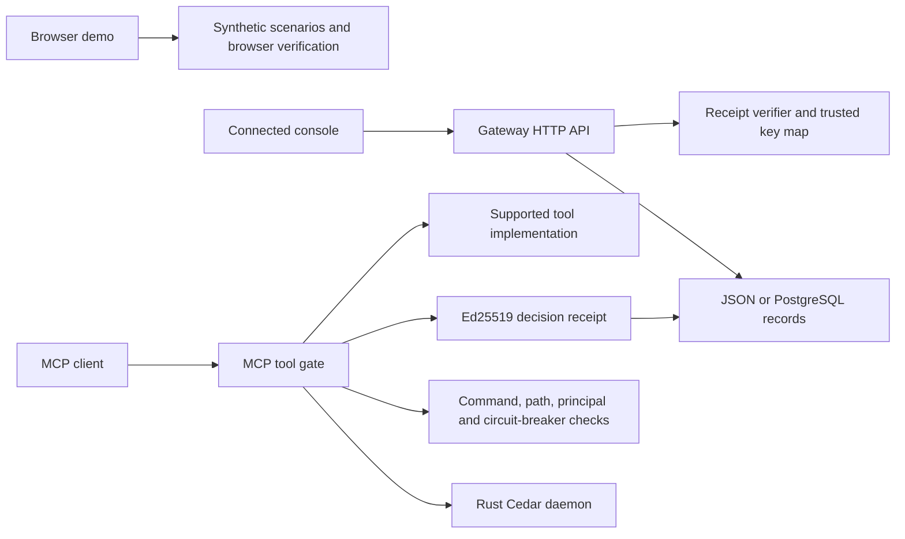

# Architecture and trust boundaries

FidusGate combines an MCP policy gateway with a console for inspecting decisions and verifying receipts. It has two frontend build modes: a static public demo and a gateway-connected console. This document describes the current source tree; it is not a production deployment certification.

## Runtime map

The diagram groups responsibilities; an allow decision or receipt alone does not demonstrate that a tool completed. Only calls sent through FidusGate’s supported interfaces encounter its checks. It does not intercept arbitrary tools or host processes.

## Source map

| Path | Responsibility |
| --- | --- |
| [`apps/admin-dashboard`](../apps/admin-dashboard/) | React/Vite frontend, static demo, and connected workspaces |
| [`apps/secure-gateway/src/index.ts`](../apps/secure-gateway/src/index.ts) | HTTP API, authentication wiring, receipt endpoints, and operator workflows |
| [`apps/secure-gateway/src/mcp-server.ts`](../apps/secure-gateway/src/mcp-server.ts) | MCP tool dispatch and receipt-bearing tool responses |
| [`apps/secure-gateway/src/cedar-remote.ts`](../apps/secure-gateway/src/cedar-remote.ts) | Remote Cedar decision handling and unavailable-daemon denial |
| [`packages/cedar-daemon/src/main.rs`](../packages/cedar-daemon/src/main.rs) | Rust `cedar-policy` engine over HTTP using `tiny_http` |
| [`packages/crypto-utils/src/index.ts`](../packages/crypto-utils/src/index.ts) | Ed25519 signing/verification, receipt hashing, chain checks, and KMS providers |
| [`packages/database/src/index.ts`](../packages/database/src/index.ts) | JSON/Prisma persistence and receipt-store initialization |
| [`packages/core-types/src/index.ts`](../packages/core-types/src/index.ts) | Shared receipt, transaction, and log types |
| [`packages/github-action`](../packages/github-action/) | Repository workflow and receipt-checking action |
| [`policy.cedar`](../policy.cedar) · [`policy.cedarschema`](../policy.cedarschema) | Authorization policies and schema |
| [`protect-mcp.config.json`](../protect-mcp.config.json) | Gateway mode and receipt-related configuration |
| [`scripts`](../scripts/) | Build, verification, sandbox, and maintenance tools |

The npm workspaces use Turborepo for task ordering and caching. The gateway’s development script compiles and starts once; it does not hot-reload TypeScript. Root `npm run dev` starts workspace development tasks but does not start Cedar or build all shared packages. See [getting started](getting-started.md) for explicit startup commands.

## Frontend modes

### Public static demo

`VITE_FIDUSGATE_DEMO=true` selects the browser-only demo at build time. [GitHub Pages](github-pages-demo.md) hosts the resulting static assets under `/FidusGate/`.

The demo uses synthetic decisions, deterministic scenario rules, and a public demo verification key. Scenario replay does not evaluate Cedar or execute tools. Receipt verification is real Ed25519 verification in the browser; pasted payloads are not sent to a backend. There is no development bootstrap login or gateway connection in this mode.

### Gateway-connected console

The normal build uses the configured gateway. Its primary workspaces are **Decisions**, **Policy playground**, and **Receipt verifier**. **Transactions**, **Governance**, **Forensics**, and **Sandbox** retain their operational workflows.

During local development, Vite proxies `/api` and `/health` to port 3001 and `/metrics` to port 3002. `FIDUSGATE_API_TARGET` and `FIDUSGATE_METRICS_TARGET` override those targets. The gateway metrics listener defaults to loopback; the gateway HTTP listener currently does not. The container proxy exposes health, not the private metrics listener.

After sign-in, authenticated reads poll every four seconds after the previous batch finishes. The browser cannot attach the Authorization header required by the gateway WebSocket upgrade, so polling preserves that guard. Credentials stay in memory. Disconnect clears session-owned UI and pending client-side sequences; it does not revoke an issued JWT or undo requests already submitted.

See [connected-console behavior](CONNECTED-CONSOLE-REDESIGN.md) for role restrictions, confirmations, and stale-response handling.

## Authorization and execution

The gateway’s supported MCP tool path checks `execute_command`, `write_file`, `read_file`, `patch_file`, `search_code`, and `list_directory`. `submit_ibp_synthesis` is a separate operation; it bypasses that Cedar tool gate and does not issue the same decision receipt.

The Rust daemon exposes `/authorize` on port 50051 and reads the policy and schema. It is an HTTP service, not gRPC. The gateway defaults to a 500 ms remote-decision timeout. Unavailable or invalid authorization results deny by default. A development-only flag can enable the limited TypeScript evaluator; production forbids that fallback. It must not be described as equivalent to the Rust engine.

The Policy playground’s active/draft simulator uses the TypeScript permit/forbid subset. Presets and simulations do not execute tools. Applying a policy is a separate, confirmed administrator operation.

Command auditing, sensitive-path checks, principal signatures, circuit breakers, quarantine, and sandbox constraints are additional boundaries. Their precise applicability depends on the route and tool. Keep authorization, execution, and audit evidence distinct when extending a path.

## Receipts and verification

A decision receipt contains the signed payload and signature metadata. The gateway resolves issuer keys from its trusted map when verifying a receipt; an untrusted key supplied by a caller is not sufficient. MCP receipt issuance uses the configured development signing material when available. The original command output or file contents remain in the first MCP text block; a receipt reference (normally its hash) is returned in a separate text block. The full receipt is persisted in the audit store and retrieved through the authenticated receipt API.

The JSON receipt store keeps newest records first. Its hash links connect each record to the preceding chronological record. Two separate checks matter:

- **Signature verification** checks the signed payload against the resolved public key.
- **Chain verification** checks the supplied record hashes and their links. It does not replace signature verification or establish that no records were omitted outside the supplied history.

Neither check alone proves that an allowed tool executed successfully, that an issuer represents a trusted real-world identity, or that local development keys provide non-repudiation.

Fresh development JSON stores receive three signed, chained examples only after the gateway resolves its signing key. Their reasons explicitly state that no tool was executed. Existing stores are preserved. [Development seed repair](development-receipt-seeds.md) is an explicit backed-up operation restricted to the exact old placeholder dataset.

## Persistence and identity

Local development stores JSON files under `packages/database/data/`. Configuring `DATABASE_URL` selects PostgreSQL/Prisma behavior; production guards reject JSON fallback. Database schema and provider code do not by themselves establish a validated production deployment.

The current console session is a development bootstrap flow: a configured `FIDUSGATE_BOOTSTRAP_KEY` authorizes issuance of a role-scoped HS256 JWT. The key can mint administrator sessions and must remain private. The production OIDC BFF/JWKS verifier is not implemented, so production startup deliberately refuses to run even when OIDC settings are present.

Cryptographic provider code includes local, AWS, GCP, and Vault paths. A default local signer is development material. Production prerequisites, KMS failure behavior, and key trust must remain fail-closed; provider integration code is not evidence that a cloud deployment has been exercised.

## Retained reference workflows

Transactions, consensus approvals, budget controls, forensic exports, drift inspection, policy assistance, and sandbox playbooks remain available through the connected console. They carry their own role and route checks. Some surrounding telemetry is simulated: syscall auditing models command strings rather than attaching kernel probes, and illustrative identity metadata does not establish a production federation.

Sandbox execution depends on its runtime and configuration. Do not infer isolation from a UI badge, a successful health check, or an illustrative WASM result. The generated `cedar-eval.wasm`, `cedar.wasm`, and `compiler.wasm` files are not Cedar runtimes.

## Verification and further reading

The repository Definition of Done is [`scripts/harness/verify.sh`](../scripts/harness/verify.sh). Dashboard tests and a Pages build establish a narrower result than gateway, Cedar, or integration checks. Gateway/database tests can alter local state; use a dedicated test checkout rather than a live console’s datastore.

- [Threat model](adr/0000-threat-model.md)
- [Production authentication boundary](adr/0002-production-auth-mcp.md)
- [KMS and persistence boundary](adr/0003-production-kms-postgres.md)
- [Sandbox and supply-chain boundary](adr/0004-production-sandbox-supply-chain.md)
- [Data and AI honesty](adr/0006-data-ai-honesty.md)
- [MCP transport migration notes](mcp-2026-07-28-migration.md)
